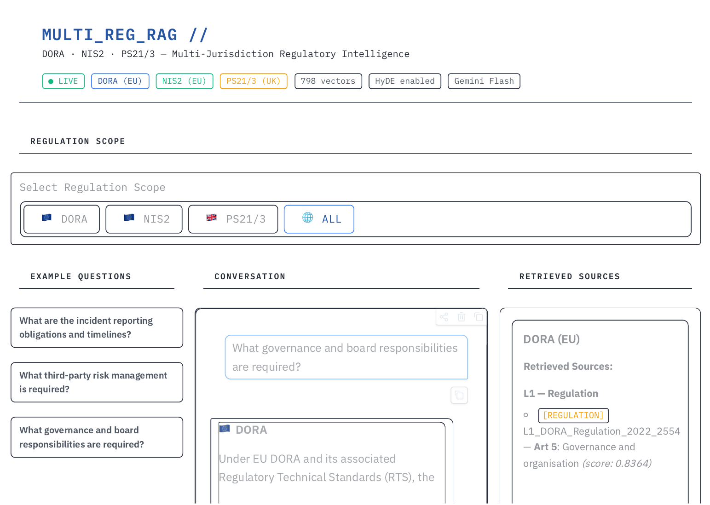

# Multi-Regulation RAG System for EU/UK Financial Regulation

A retrieval-augmented generation (RAG) system that answers compliance questions on operational resilience regulation and cites the exact article it relies on. It covers the EU Digital Operational Resilience Act (DORA), the EU NIS2 Directive and the UK's FCA/PRA PS21/3.

*Individual assignment, IB9AU0 Generative AI and AI Applications, MSc Financial Technology, Warwick Business School (April 2026).*



## Why RAG for regulation

General-purpose LLMs are poorly suited to legal text: meaning depends on exact wording, and recent regulatory standards may not be in a model's training data. Prompting alone risks invented obligations. Grounding answers in retrieved source text, with article-level citations, makes them traceable, which matters more than fluency in a compliance setting.

## What it does

- **Covers three frameworks across two jurisdictions:** DORA and NIS2 (EU) and PS21/3 (UK), plus documents that cover more than one regulation, such as the EU guidelines on how DORA and NIS2 relate.
- **Treats the corpus as a legal hierarchy:** Level 1 (primary legislation), Level 2 (technical standards such as RTS and ITS, and supervisory statements) and Level 3 (guidelines, Q&As and public statements).
- **Lets you set the scope:** search DORA, NIS2 or PS21/3 alone, or all of them together.
- **Cites its sources:** every answer names the regulation, document, level and article it came from.

## Architecture

The pipeline has six stages, each in its own notebook:

| Stage | Notebook(s) | What happens |
|---|---|---|
| 1. Ingestion | `01a`, `01b` | Load official PDFs and strip repeated headers and formatting noise |
| 2. Chunking | `02`, `02b` | Split by article and paragraph rather than fixed length. Tag each chunk with regulation, jurisdiction, level, document type and article number |
| 3. Indexing | `03a`, `03b` | Embed 798 chunks with `BAAI/bge-large-en-v1.5` (1,024 dimensions) and store them in ChromaDB |
| 4. Retrieval | `04a`, `04b` | Combine dense vector search with BM25 keyword search using Reciprocal Rank Fusion. Route each query to the right regulation and use HyDE query expansion |
| 5. Generation | `05b` | Generate the answer with Gemini Flash using a citation-focused prompt (Groq Llama 3.3 70B was used earlier in development) |
| 6. Evaluation | `06b` | Score retrieval and generation against a benchmark question set |

Notebooks marked `a` are the first DORA-only build. Notebooks marked `b` extend it to all three regulations.

## Results

Final multi-regulation evaluation (from [`evaluation/scorecards`](evaluation/scorecards/)):

| Retrieval | DORA | NIS2 | PS21/3 |
|---|---|---|---|
| Source hit rate | 93% | 92% | 100% |
| Article hit rate | 89% | 83% | 100% |
| Mean reciprocal rank (MRR) | 0.59 | 0.86 | 0.87 |

| Generation | Score |
|---|---|
| Faithfulness | 100% |
| Answer relevancy | 100% |
| Citation rate | 100% |
| Obligation coverage | 90% |
| Hallucination guard (refuses out-of-scope questions) | 100% |

The weakest area is adversarial DORA queries, with a 60% source hit rate in the baseline. Adding a cross-encoder reranker is the main planned improvement. See the [report](docs/report.pdf) for the full evaluation and reflection.

## Repository structure

```
regtech-rag/
├── notebooks/        # six-stage pipeline (01 ingestion → 06 evaluation)
├── app/rag_demo.py   # Gradio web interface
├── config/           # index, retrieval and pipeline settings
├── evaluation/       # benchmark scorecards (baseline and multi-regulation)
├── data/             # list of source documents (PDFs not included)
└── docs/             # report, commentary appendix and demo walkthrough
```

## How to run

1. Install the dependencies:
   ```bash
   pip install -r requirements.txt
   ```
2. Copy `.env.example` to `.env` and add your own Gemini key (from [Google AI Studio](https://aistudio.google.com)). A Groq key is only needed for the earlier notebooks.
3. Download the source documents listed in [`data/README.md`](data/README.md).
4. Run the notebooks in order (`01` → `06`) to build the chunks and the ChromaDB index.
5. Launch the web app, which opens at `http://localhost:7860`:
   ```bash
   python app/rag_demo.py
   ```

The notebooks and app were developed in a single working folder, so file paths in `config/` may need adjusting to match where you put the generated data.

## Tech stack

Python · LlamaIndex · ChromaDB · Hugging Face (BGE embeddings) · BM25 · Google Gemini · Groq · Gradio · pdfplumber
