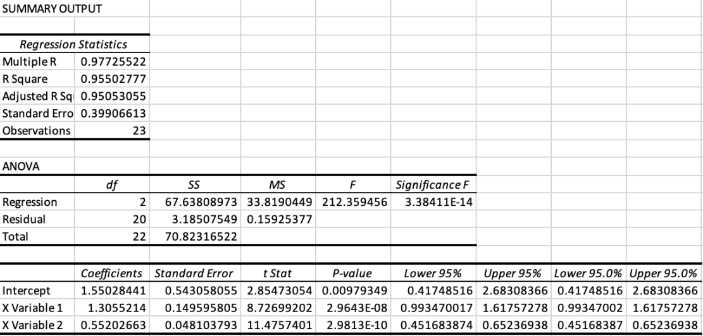
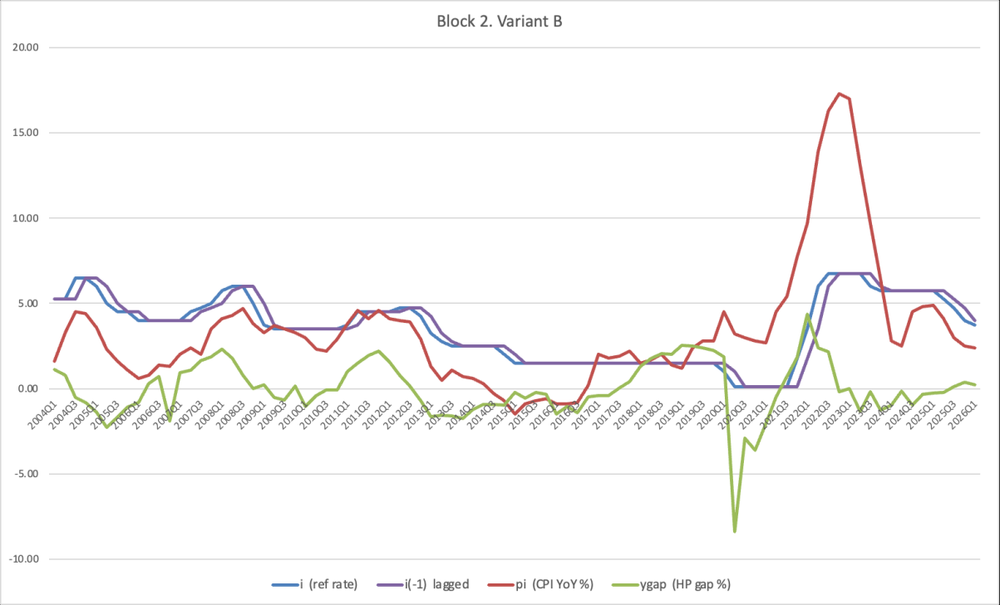

# Taylor's Rule and Monetary Policy in Poland

Does a simple, US-calibrated Taylor rule describe how the National Bank of Poland (NBP) sets interest rates? This project replicates Taylor's (1993) original US result and then estimates the rule for Poland over its inflation-targeting period, 2004–2026.

*Individual assignment, IB9HI0 Case Studies in Data Science and Economics, MSc Financial Technology, Warwick Business School (June–July 2026).*

## The rule

$$i_t = r^* + \pi_t + \alpha(\pi_t - \pi^*) + \beta(y_t - y_t^*)$$

The policy rate $i_t$ responds to inflation $\pi_t$ relative to the target $\pi^*$ and to the output gap $y_t - y_t^*$. Taylor set $r^* = 2$, $\pi^* = 2$ and $\alpha = \beta = 0.5$, which implies a total inflation response of 1.5. The rule satisfies the **Taylor principle** when that response is above 1, meaning the real rate rises when inflation rises.

## Part 1: Replicating Taylor (1993) for the US

OLS on 23 quarters (1987Q1–1992Q3) closely matches Taylor's calibration:

| | Taylor (1993) | OLS estimate |
|---|---|---|
| Constant | 1.0 | 1.55*** |
| Inflation | 1.5 | 1.31*** |
| Output gap | 0.5 | 0.55*** |
| R² | – | 0.955 |



## Part 2: Extending the rule to Poland

Poland is a harder test than the US. It is a medium-sized open economy with a floating currency, a higher and less certain neutral rate, and a 2.5% ± 1pp inflation target that has been stable only since 2004. The rule is estimated on two samples:

- **Block 1 (2004Q1–2019Q4):** a stable period before COVID.
- **Block 2 (2004Q1–2026Q1):** adds the post-COVID inflation surge and the 2022 energy shock after Russia's invasion of Ukraine.

Each block is estimated in two variants:

- **Variant A:** no smoothing. The NBP is assumed to reset the rate fully each quarter.
- **Variant B:** smoothing. Last quarter's rate is added as a regressor, since central banks in Central and Eastern Europe are known to move rates gradually.

| | Block 1, A | Block 1, B | Block 2, A | Block 2, B |
|---|---|---|---|---|
| Intercept | 1.828 | 0.043 | 2.586 | 0.116 |
| Lagged rate, ρ | – | 0.921*** | – | 0.901*** |
| Inflation | 0.778*** | 0.078* | 0.276*** | 0.064*** |
| Output gap | −0.391*** | 0.060 | 0.057 | 0.118*** |
| Long-run inflation response, π/(1−ρ) | – | 0.986 | – | 0.649 |
| Long-run output-gap response, y/(1−ρ) | – | 0.755 | – | 1.193 |
| R² | 0.566 | 0.951 | 0.289 | 0.953 |
| Observations | 64 | 64 | 89 | 89 |

\*\*\* p < 0.01, \* p < 0.10



## Findings

- **The rule does not transfer to Poland unchanged.** Without smoothing it fits poorly (R² falls to 0.29 on the full sample), and in Block 1 the output-gap coefficient even has the wrong sign.
- **The NBP smooths its rate.** Adding the lagged rate lifts R² to about 0.95 in both samples, with a smoothing parameter of about 0.9.
- **It falls short of the Taylor principle.** Even with smoothing, the long-run inflation response is below 1 (0.99 before COVID and 0.65 including 2020–26). The most likely reasons are that the NBP reacts to inflation forecasts rather than current inflation, and that it treated the 2021–22 surge as external and temporary.
- **Conclusion:** for Poland, the Taylor rule works as a descriptive benchmark of the NBP's systematic behaviour, not as a policy prescription. A natural extension would add a PLN/EUR exchange-rate term.

## What's in this folder

```
taylor-rule-poland/
├── model/poland_taylor_rule_regression.xlsx   # the Excel model
├── code/hp_filter.py                          # HP filter for the output gap
├── figures/                                   # US replication, Polish data charts
│   └── regression_outputs/                    # full Excel regression output, all four models
└── docs/report.pdf                            # full report with appendices
```

**The Excel model** contains:

| Sheet | Contents |
|---|---|
| `Poland_Data (2)` | Quarterly dataset, 2004Q1–2026Q1, with the input series and formula columns |
| `Block 1/2. Variant A/B` | Excel Data Analysis regression output for each of the four models |
| `Sheet8` | Summary table of all four regressions (the table above) |
| `Sheet9` | Data sources and links |
| `Sheet10` | Guide to the columns in the dataset |

**The Python script** applies the Hodrick-Prescott filter (λ = 1,600) to log real GDP to estimate the output gap used in the regressions. To run it, save a `real_gdp.xlsx` file next to it, with quarterly real GDP in the first column below a header row:

```bash
pip install numpy openpyxl statsmodels
python code/hp_filter.py
```

## Data

| Series | Source |
|---|---|
| NBP reference rate | [National Bank of Poland](https://nbp.pl/en/) |
| CPI inflation (year on year) | [NBP / Statistics Poland (GUS)](https://nbp.pl/en/statistic-and-financial-reporting/economic-indicators/) |
| Real GDP, seasonally adjusted | [IMF via FRED (NGDPRSAXDCPLQ)](https://fred.stlouisfed.org/series/NGDPRSAXDCPLQ) |
| Inflation target | NBP Monetary Policy Strategy (2003) |

## Tools

Excel (Data Analysis OLS regression, formulas, charts) · Python (statsmodels HP filter)
