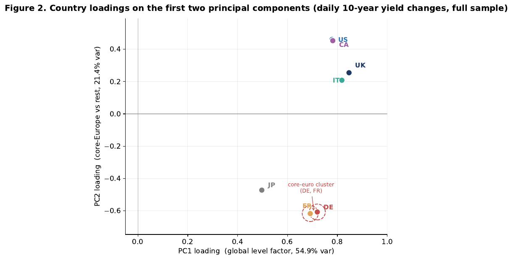
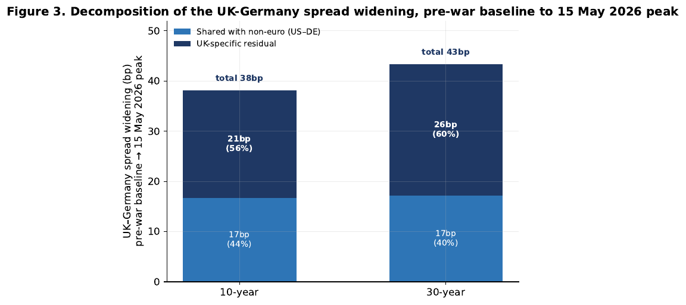
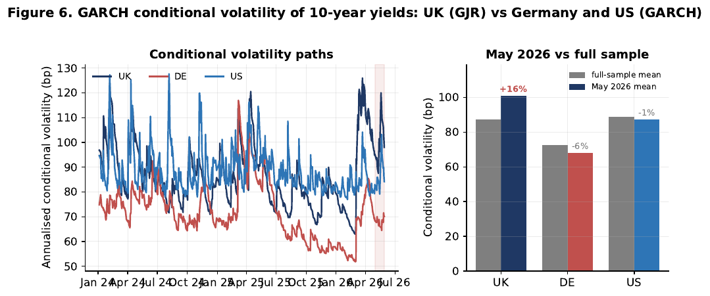

# UK Gilt Market Analysis: Testing the FT's "Britain's Debt Cage"

A quantitative test of two claims in the Financial Times "Big Read" *Britain's debt cage* (Smith, Fleming and Parker, 15 May 2026):

1. UK gilts have become "untethered" from peer bond markets.
2. UK borrowing costs carry an extra risk premium since the 2022 Truss episode, the so-called "moron premium".

The article makes both claims through quotes and a line chart but never measures them. This project uses principal component analysis (PCA), spread decomposition and GARCH volatility models to put numbers on them.

*Individual assignment, IB99L0 Financial Analytics, MSc Financial Technology, Warwick Business School (May–June 2026).*

## Key findings

**Gilts are not untethered day to day.** A PCA of daily 10-year yield changes across seven countries finds a common global factor (PC1) that explains 54.9% of total variance. The UK loads on it at 0.85, the highest of the seven countries, so about 72% of the variance in daily gilt moves is global (the seven-country average is 55%). The result holds when Japan and Canada are dropped from the panel. Against only its core euro peers, though, the UK stands somewhat apart.



**The premium lives in levels.** UK yields averaged 186bp above Germany at 10 years and 218bp at 30 years. In the run-up to the article (end of February to 15 May 2026) the UK–Germany spread widened by 38bp at 10 years and 43bp at 30 years. Most of that widening (56% and 60%) was UK-specific rather than shared with other non-euro markets.



**The May 2026 sell-off was a parallel shift.** A PCA of the UK curve (2y, 5y, 10y and 30y) recovers level (90.1% of variance), slope (9.0%) and curvature (0.8%). The 1–15 May move was 99% a level shift: the whole curve rose by 10–16bp rather than steepening at the long end.

**UK volatility reacts more to bad news.** UK volatility averages about 87bp a year, close to the US (89bp) and above Germany (72bp). For the UK only, a GJR-GARCH model fits better than plain GARCH (AIC 3,230 vs 3,235): sell-offs raise next-day volatility more than rallies of the same size, and shocks take about 17 trading days to halve. In May 2026, UK volatility rose 16% above its average while Germany's fell.



**Conclusion:** "untethered" is a story about levels, not co-movement. Gilts move closely with world markets each day but trade at a persistent and growing premium, and their volatility responds asymmetrically to domestic bad news.

## Method

| Step | Notebook | What it does |
|---|---|---|
| 1 | `1_load_yields.ipynb` | Loads yields from seven sources, handles each source's formatting quirks, aligns them to common trading days and builds the daily basis-point change panel |
| 2 | `2_pca.ipynb` | Cross-country PCA of 10-year changes: global factor, loadings, systematic vs idiosyncratic share |
| 3 | `3_pca.ipynb` | 63-day rolling PCA to test whether the UK's idiosyncratic share spiked around May 2026 |
| 4 | `4_pca.ipynb` | Robustness: reruns the PCA on different country panels |
| 5 | `5_pca_levels.ipynb` | UK–Germany and UK–peer spreads, with the widening split into shared and UK-specific parts |
| 6 | `6_pca_ukcurve.ipynb` | UK curve PCA (level, slope, curvature) and decomposition of the May 2026 move |
| 7 | `7_pca_garch.ipynb` | GARCH vs GJR-GARCH(1,1) with Student-t errors for UK, Germany and US 10-year yields |
| 8 | `8_make_figures.ipynb` | Produces the report figures |

**Data:** daily government bond yields from 5 January 2024 to 29 May 2026 for the UK, US, Germany, France, Italy, Japan and Canada (519 common trading days). Sources are listed in [`data/README.md`](data/README.md).

## Repository structure

```
uk-gilt-pca/
├── notebooks/   # steps 1–8
├── results/     # output tables (PCA loadings, variance explained, spreads, GARCH)
├── figures/     # report figures (PNG and PDF)
├── data/        # data sources (raw files not included)
└── docs/        # report and mathematical appendix
```

## How to run

1. Install the dependencies:
   ```bash
   pip install -r requirements.txt
   ```
2. Download the yield data listed in [`data/README.md`](data/README.md) and save it in `notebooks/data/` using the file names given there.
3. Run the notebooks in order from `1` to `8`. Each one writes its outputs next to itself.

## Tech stack

Python · pandas · NumPy · arch (GARCH) · Matplotlib

## Documents

- [Report](docs/report.pdf)
- [Appendix A: mathematical derivations](docs/appendix_a_derivations.pdf)
